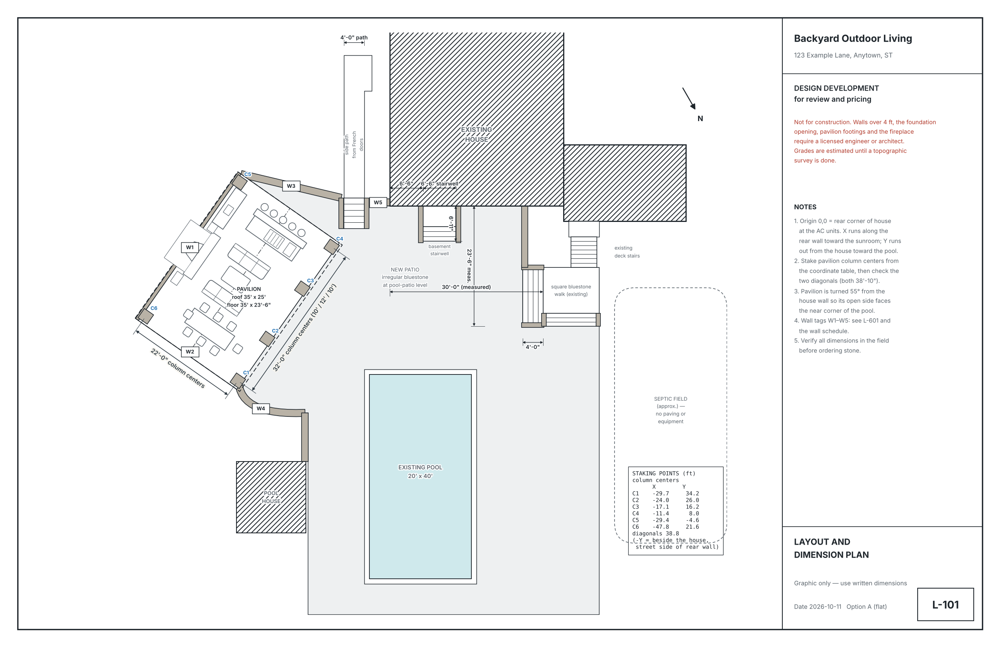

# Backyard Design — an AI skill for homeowners

A Claude skill that takes a homeowner from **photos and an idea** to a **design-development package** for a backyard renovation: design options, photoreal renderings of their own yard, an 8-sheet drawing set, a budget, a scope of work, a bid form and a permits checklist.

It was built from a real project: a flat bluestone patio connecting a house to its pool, with an angled covered pavilion, fireplace and outdoor kitchen.



## What it does

1. **Intake.** The homeowner shares a photo and a marked-up copy; the AI restates the idea and confirms it.
2. **Photo shot list.** Exactly where to stand and which way to face, numbered so photos match.
3. **Measurements and questions.** Only the measurements that change the design, with the math shown.
4. **Survey.** Reads the property survey, places the house on it, checks setbacks and zoning.
5. **Concept options.** Two options as dimensioned plans plus a grade section, revised with the homeowner.
6. **Photoreal renderings.** Edits the homeowner's own photos; uses colored markup guides for steps and level changes.
7. **Drawing set and bid package.** Sheets L-000 to L-601, schedules, scope, bid form, budget, permits.

## What it does not do

It does not produce sealed construction drawings. Retaining walls over about 4 ft, foundation openings, roofed structures and footings, fireplaces, gas and septic work need a licensed engineer or architect. Every sheet says so. The aim is to let a homeowner understand cost and options **before spending money**, and to hand a professional a strong starting point instead of a blank page.

## Install

- **Claude (claude.ai / desktop):** upload the `backyard-design` folder (or `SKILL.md`) as a skill in Settings → Capabilities → Skills.
- **Claude Code:** copy the folder to `~/.claude/skills/backyard-design/`.

## Drawing templates

`scripts/` holds the matplotlib + shapely code that drew the example set. Edit `scripts/config.py` (project name, address, lot dimensions, house placement), then adjust the geometry at the top of `plan.py`, `plan_angled.py` and `sheets.py` for your site.

```bash
pip install -r requirements.txt
cd scripts
python3 plan_angled.py a option_a.png   # concept plan, option A
python3 section.py grade_section.png    # grade section
for s in sheet_l0*.py sheet_l[1-6]*.py; do python3 $s; done   # L-000 ... L-601
```

`examples/` shows the sheets these scripts produce with the example config. The geometry is one specific yard; treat it as a template, not a generator.

## Tips learned the hard way

- Confirm what each markup color means before designing.
- For a basement walkout, measure both floor-to-sill **and** sill-to-outside-ground.
- Check the survey's setbacks before you render anything final.
- Image models struggle with level changes: draw HIGH/LOW labels, DOWN arrows and one side wall per side of each flight onto the render, then ask the model to follow the markup.

## License

MIT. Use at your own risk; not professional design or engineering advice.
